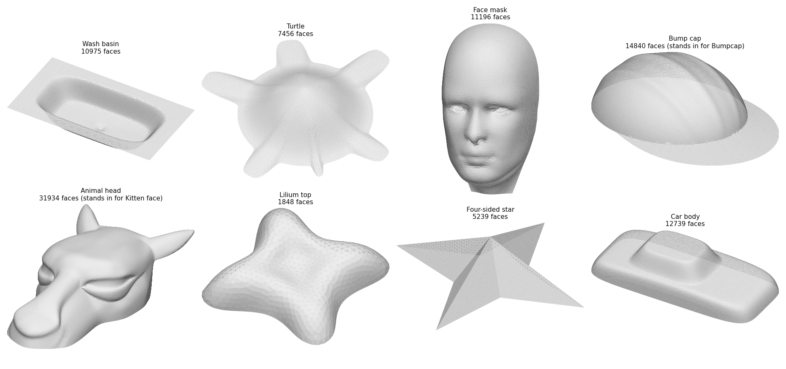
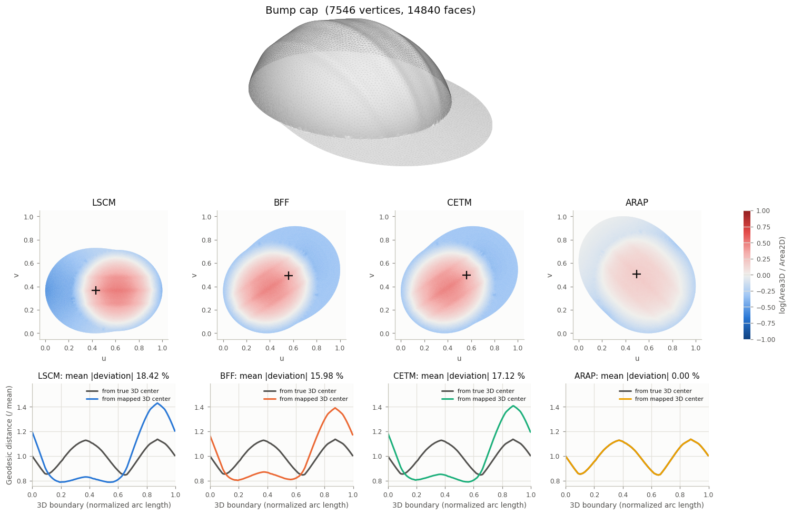
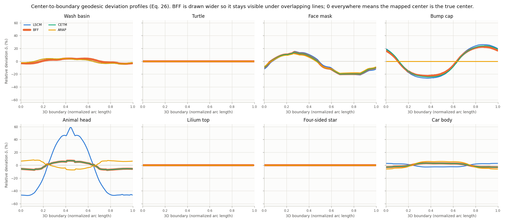
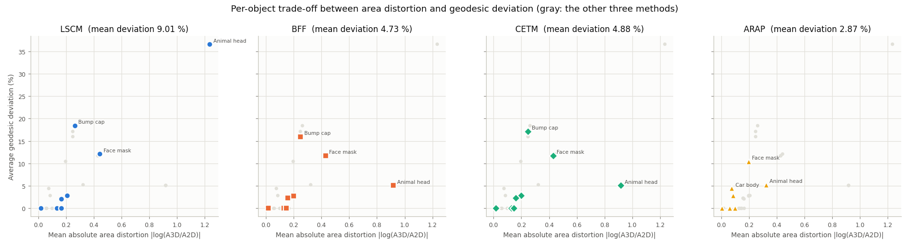
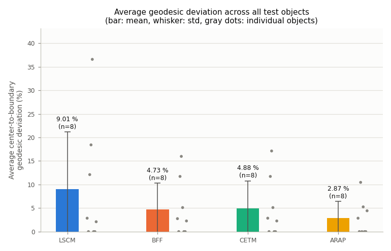
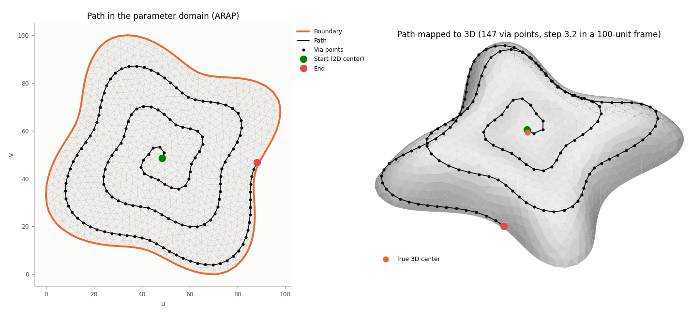
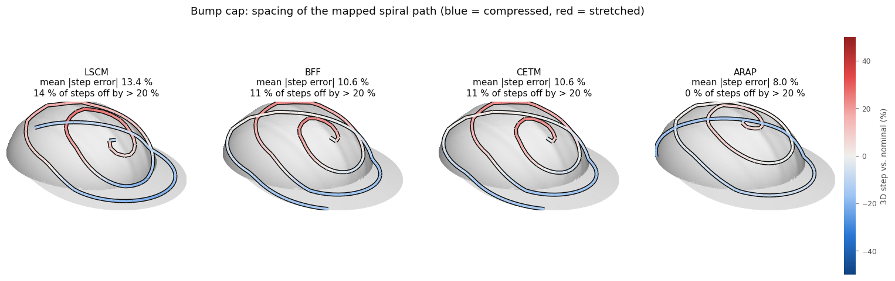

# Mesh flattening for 3D path planning: a replication of Mahrukh et al. (Robotics 2025)

This repository re-implements and re-runs the comparison in

> M. Mahrukh, G. Palli, M. Gambazza, C. Melchiorri. *Comparative Study on the Suitability of
> Free-Boundary Parameterization Techniques for 3D Geometry-Aware Path Generation.*
> Robotics 2025, 14(11), 160. https://doi.org/10.3390/robotics14110160
> (PDF: [robotics-14-00160-v2.pdf](robotics-14-00160-v2.pdf))

The paper flattens open 3D meshes with four free-boundary parameterizations (LSCM, BFF, ARAP,
CETM), plans a spiral path in the 2D domain, maps it back to 3D, and compares the methods by
area distortion and a new **center-to-boundary geodesic deviation (CBGD)**. Here the four methods
are implemented from scratch with NumPy/SciPy, one module per method. They run on eight open,
disk-topology meshes chosen to resemble the paper's objects, and are evaluated with the paper's
measures plus a few extra ones.

## Headline result

| | LSCM | BFF | CETM | ARAP |
|---|---:|---:|---:|---:|
| **CBGD, this replication** (mean +- std over 8 objects) | 9.01 +- 12.18 % | 4.73 +- 5.62 % | 4.88 +- 5.91 % | **2.87 +- 3.51 %** |
| CBGD, paper (Fig. 12; BFF and CETM read off the bar chart) | 7.65 % | ~3.9 % | ~6.1 % | **1.7 %** |
| Mean area distortion, mean \|log(A3D/A2D)\| | 0.328 | 0.280 | 0.280 | **0.113** |
| Mean angle distortion (degrees, extra metric) | 0.37 | 0.37 | **0.36** | 3.66 |
| Spiral path: mean 3D step error vs. nominal (extra metric) | 13.4 % | 10.1 % | 10.1 % | **7.9 %** |

**What reproduces:**
- **Ranking.** ARAP has the lowest average deviation and the smallest spread, LSCM the highest
  and the largest spread, and BFF/CETM fall in between. The independent path-spacing measure
  gives the same order.
- **Trade-off.** On average ARAP has 2.5-2.9x less area distortion than the conformal methods,
  which in turn have about 10x less angle distortion. That is the conformal vs. rigid trade-off
  the paper describes.
- **Per-object findings.** The largest, least uniform errors occur on the strongly curved
  shapes: the bump cap, the face mask and the animal-head stand-in for the kitten face. LSCM has
  the highest peak (58.6 % on the animal head), as in the paper, where Bumpcap and Kitten face were
  worst and LSCM peaked highest. The creased four-sided star is perfect for every method.

**What differs:**
- **BFF vs. CETM.** CETM is not worse than BFF here: both use the same boundary condition
  (boundary lengths kept, u_b = 0), and BFF is the linearization of the same discrete conformal
  problem, so the two give nearly identical maps (see *Notes*).
- **Timing order.** Ours is BFF < LSCM < CETM < ARAP; the paper's is LSCM < ARAP < BFF < CETM.
- **Absolute values.** Only the lilium is the paper's source model, so absolute numbers are not
  directly comparable.

## Quick start

```bash
python -m venv .venv
.venv\Scripts\activate            # Windows  (Linux/macOS: source .venv/bin/activate)
pip install -r requirements.txt

python run_experiments.py         # flatten + evaluate all 8 meshes x 4 methods (~1.5 min)
python make_figures.py            # figures in results/figures, tables in results/tables.md
python -m pytest                  # 24 correctness tests (~3 s)
python make_meshes.py             # optional: rebuild meshes/ from scratch (~1.5 min, needs internet)
```

The committed meshes are the exact ones behind the reported numbers. PyMeshLab's remeshing is
not bit-reproducible across runs, so `make_meshes.py` gives slightly different meshes each time
(see *Robustness*).

## Repository layout

```
flattening/            the four methods; each exposes flatten(V, F) -> UV
  common.py              mesh loading/cleaning, boundary loop, cotan Laplacian, harmonic extension,
                         closed boundary curve from lengths + turning angles
  lscm.py  bff.py  arap.py  cetm.py
evaluation.py          area distortion, exact geodesics, 3D and 2D centers, barycentric back-projection,
                       CBGD (Eq. 26), spiral path, tool poses (Eqs. 23-24)
make_meshes.py         builds meshes/*.obj (procedural shapes + cuts of libigl models, PyMeshLab remeshing)
run_experiments.py     runs everything, writes results/summary.csv and results/data/*.npz
make_figures.py        figures (counterparts of the paper's Figs. 1-12) and results/tables.md
tests/                 correctness tests (theory checks, exact isometry, libigl cross-checks)
meshes/                the eight test meshes
results/               summary.csv, tables.md, figures/
```

## Test meshes



| This repo | Paper object | Source | Faces (ours / paper) |
|---|---|---|---:|
| Wash basin | Wash basin | procedural: rectangular slab, rounded-rectangle bowl, drain recess | 10,975 / 10,902 |
| Turtle | Turtle | procedural: domed shell with scutes, head, four flippers, tail | 7,456 / 7,600 |
| Face mask | Face mask (a cowl) | front of the libigl `face.obj` head scan, cut in front of the ears and above the chin | 11,196 / 11,168 |
| Bump cap | Bumpcap | procedural: near-hemispherical ellipsoidal dome with ribs and a creased visor | 14,840 / 15,082 |
| Animal head | Kitten face | top half of the libigl `camelhead.off` (ears, eyes, forehead, upper snout) | 31,934 / 31,954 |
| Lilium top | Lilium top | libigl `lilium.obj`, which matches the paper's figure | 1,848 / 1,844 |
| Four-sided star | Four-sided star | procedural: star pyramid of eight planar facets (creased) | 5,239 / 5,344 |
| Car body | Car body | procedural: rounded body shell with steep sides and a cabin | 12,739 / 12,763 |

- **Cleaning.** Every mesh goes through the paper's cleaning step: merge duplicate vertices,
  drop degenerate, duplicate and unreferenced faces, make the winding consistent, keep the
  largest component. It is then checked to be a topological disk.
- **Remeshing.** Every mesh is then remeshed with the PyMeshLab filter the paper uses
  (`meshing_isotropic_explicit_remeshing`, 10 iterations, 30 degree crease angle). The target edge
  length is chosen to match the paper's face count, which gives mean edge lengths of 0.65-2.7 %
  (mostly ~1 %) of the bounding-box diagonal.
- **Lilium.** The remeshed lilium (974 vertices / 1,848 faces) is almost identical to the
  paper's (975 / 1,844). Together with the matching shape, this suggests the paper used the same
  model.
- **libigl sources.** The libigl models come from
  [libigl-tutorial-data](https://github.com/libigl/libigl-tutorial-data), pinned to commit `644dd41`.
  That repository has no explicit license, and it lists the origin of `face.obj` and `lilium.obj`
  as unknown; `camelhead.off` is from Sorkine et al. 2004.

## Methods as implemented

**LSCM** ([flattening/lscm.py](flattening/lscm.py))
- Minimizes the conformal energy E_C = E_D - A = 1/2 x^T (L (x) I_2 - 2 A_vec) x, which is the
  sparse system quoted in the paper: Dirichlet energy minus the signed area of the map.
- The two boundary vertices that are farthest apart are pinned to (0, 0) and (1, 0).
- Solved with a sparse direct solver.
- Cross-check: the result matches libigl's `lscm` to 1e-9.

**BFF** ([flattening/bff.py](flattening/bff.py)), minimum-distortion setting u_b = 0:
- Interior log scale factors come from the discrete Yamabe/Cherrier relation K_new = K + L u
  with a flat interior. This is the Dirichlet-to-Neumann (Poincare-Steklov) map, realized with a
  Poisson solve.
- The new boundary exterior angles are k_new = k + (L u)_B.
- The boundary curve is integrated from the turning angles, with the edge lengths adjusted as
  little as possible so that it closes (Sawhney & Crane, Sec. 4.3).
- The interior comes from a harmonic (Laplace) extension with the input mesh's cotangent
  Laplacian, as the paper describes.

**ARAP** ([flattening/arap.py](flattening/arap.py)):
- Liu et al.'s local/global solver, with cotangent weights and one rotation per triangle.
- Local step: the closest rotation to each 2x2 Jacobian, in closed form theta = atan2(c - b, a + d).
  This is equivalent to the SVD solution and stable for near-degenerate triangles.
- Global step: a pre-factorized cotangent Laplacian solve with one vertex pinned.
- Initialization: a harmonic map whose boundary is spaced by arc length on a circle (as in the
  paper and the libigl tutorial).
- Stopping rule: iterate until the largest vertex displacement falls below 1e-6 x the mean edge
  length.
- Cross-check: after a fixed number of iterations, the result matches libigl's `arap_solve` to a
  relative 1e-8.

**CETM** ([flattening/cetm.py](flattening/cetm.py)):
- Discrete conformal scaling l_ij = exp((u_i + u_j)/2) l_ij with u = 0 at boundary vertices and
  target angle sum 2 pi at interior vertices.
- Newton's method on the convex Springborn-Schroeder-Pinkall energy: the gradient is the target
  minus the current angle sums, and the Hessian is the cotangent Laplacian. The energy uses the
  Lobachevsky function, computed via the Clausen series.
- An Armijo line search accepts only steps that keep every triangle inequality satisfied.
- Layout: the boundary polygon is built from the new lengths and exterior angles, then extended
  harmonically with the cotangent weights of the *new flat metric*. By linear precision this
  reproduces the developed triangles exactly; tests confirm edge lengths and 2 pi angle sums to 1e-8.

## Evaluation as implemented ([evaluation.py](evaluation.py))

- **Area distortion.** Per face, log(A3D / A2D), with both domains scaled to unit total area.
  The maps use UV scaled to the unit box and a color range of +-1, as in the paper. The summary
  value is the mean of the absolute value over faces.
- **True center P_t.** The vertex with the largest exact geodesic distance to the boundary
  (MMP algorithm via `pygeodesic`).
- **Mapped center P_m.**
  - Start from the pole of inaccessibility of the UV boundary polygon (polylabel branch and
    bound, tolerance 1e-4 of the UV size).
  - Locate it in the UV mesh and back-project it with barycentric weights (Eq. 22), using the
    paper's rules: accept weights >= -1e-9, clamp and renormalize, break ties by the largest
    minimum weight.
  - Snap to the vertex of the containing triangle closest to the back-projected 3D point.
    Geodesics are vertex-sourced and P_t is a vertex, which is also why the paper's Fig. 10
    shows exact zeros.
- **CBGD.** delta_i = (d(P_m, b_i) - d(P_t, b_i)) / d(P_t, b_i) over all boundary vertices (Eq. 26).
  The "average geodesic deviation" is the mean of |delta_i| in percent; Fig. 12 shows mean +- std
  over the objects.
- **Spiral path.**
  - Three turns from the 2D center. The radius grows with the polar angle up to 98 % of the
    distance to the boundary in that direction, so the outer turn follows the boundary.
  - The UV frame is scaled to [0, 100] with a step of 3.2, as in the paper's example.
  - Via points are back-projected with Eq. 22.
- **Path spacing (extra).** The 3D chord between consecutive via points, compared with the
  nominal step 3.2 x sqrt(A3D / A2D). The paper motivates CBGD with a 15-20 % spacing tolerance
  but does not measure spacing itself.
- **Tool poses (Eqs. 23-24).** Computed for every path and saved with the run data. The paper's
  R_i = [T_i, N_i x T_i, -N_i] has determinant -1 (a reflection), so we use
  [T_i, T_i x N_i, -N_i]. Inverse kinematics (Eq. 25) needs a robot model and is out of scope.
- **Validity checks.**
  - The paper checks positive boundary area; we also count flipped or degenerate UV triangles
    and unmapped via points.
  - All 32 runs are valid: no flipped or degenerate triangles, positive boundary area, every
    via point mapped.
- **Timing.** Median of three runs of the flattening call only (Windows 11, Python 3.11,
  NumPy 2.2, one machine).

## Results

All numbers below are also in [results/summary.csv](results/summary.csv) and
[results/tables.md](results/tables.md), which add the maximum |delta_i| and the share of path
steps off by more than 20 %.

**Average center-to-boundary geodesic deviation, mean |delta_i| (%)**

| Object | LSCM | BFF | CETM | ARAP |
|---|---:|---:|---:|---:|
| Wash basin | 2.85 | 2.76 | 2.85 | 2.85 |
| Turtle | 0.00 | 0.00 | 0.00 | 0.00 |
| Face mask | 12.11 | 11.72 | 11.72 | 10.46 |
| Bump cap | 18.42 | 15.98 | 17.12 | 0.00 |
| Animal head | 36.57 | 5.11 | 5.11 | 5.26 |
| Lilium top | 0.00 | 0.00 | 0.00 | 0.00 |
| Four-sided star | 0.00 | 0.00 | 0.00 | 0.00 |
| Car body | 2.10 | 2.27 | 2.27 | 4.43 |
| **Mean +- std** | **9.01 +- 12.18** | **4.73 +- 5.62** | **4.88 +- 5.91** | **2.87 +- 3.51** |

**Mean absolute area distortion, mean |log(A3D/A2D)|**

| Object | LSCM | BFF | CETM | ARAP |
|---|---:|---:|---:|---:|
| Wash basin | 0.207 | 0.198 | 0.198 | 0.085 |
| Turtle | 0.133 | 0.129 | 0.129 | 0.056 |
| Face mask | 0.442 | 0.429 | 0.428 | 0.196 |
| Bump cap | 0.263 | 0.248 | 0.248 | 0.099 |
| Animal head | 1.235 | 0.919 | 0.918 | 0.322 |
| Lilium top | 0.165 | 0.147 | 0.146 | 0.060 |
| Four-sided star | 0.017 | 0.016 | 0.016 | 0.006 |
| Car body | 0.164 | 0.158 | 0.158 | 0.075 |
| **Mean +- std** | **0.328 +- 0.361** | **0.280 +- 0.265** | **0.280 +- 0.265** | **0.113 +- 0.094** |

**Parameterization time in seconds (counterpart of Table 2)**

| Object | LSCM | BFF | CETM | ARAP |
|---|---:|---:|---:|---:|
| Wash basin | 0.101 | 0.068 | 0.211 | 0.589 |
| Turtle | 0.066 | 0.045 | 0.112 | 1.010 |
| Face mask | 0.116 | 0.078 | 0.248 | 0.387 |
| Bump cap | 0.164 | 0.105 | 0.318 | 0.410 |
| Animal head | 0.380 | 0.258 | 1.250 | 9.220 |
| Lilium top | 0.013 | 0.011 | 0.025 | 0.097 |
| Four-sided star | 0.049 | 0.029 | 0.066 | 0.149 |
| Car body | 0.126 | 0.084 | 0.203 | 0.418 |
| **Mean +- std** | **0.127 +- 0.105** | **0.085 +- 0.072** | **0.304 +- 0.369** | **1.535 +- 2.917** |

Paper: LSCM 0.067 +- 0.043, ARAP 0.241 +- 0.133, BFF 0.297 +- 0.522, CETM 0.457 +- 0.454 s.
Our ARAP time is set by its stopping rule. The results are identical (CBGD and area distortion
to 5 digits) for tolerances from 1e-3 to 1e-7, while the time on the animal head grows roughly
eightfold over that range.

**Per-object figures (counterparts of Figs. 2-9).** Each figure shows the area distortion maps
(+ marks the 2D center) and the geodesic distances from the true and the mapped center to the
boundary:
[wash basin](results/figures/object_wash_basin.png) ·
[turtle](results/figures/object_turtle.png) ·
[face mask](results/figures/object_face_mask.png) ·
[bump cap](results/figures/object_bump_cap.png) ·
[animal head](results/figures/object_animal_head.png) ·
[lilium top](results/figures/object_lilium_top.png) ·
[four-sided star](results/figures/object_four_sided_star.png) ·
[car body](results/figures/object_car_body.png)



**Deviation profiles (Fig. 10)**



**Area distortion vs. deviation (Fig. 11).** Faceted by method because four hues in one
scatter are not reliably distinguishable:



**Average deviation (Fig. 12)**



**Spiral path, ARAP on the lilium (Fig. 1)**



**Path spacing on the bump cap (extra).** Blue marks compressed steps, red stretched:



## Notes, robustness and caveats

- **BFF ≈ CETM.**
  - The paper gives "K̄_i = π" as the CETM target for every boundary vertex. That cannot
    satisfy the discrete Gauss-Bonnet theorem, because the boundary turning must sum to 2 pi.
  - We therefore use the standard free-boundary choice u_b = 0 (Springborn et al. 2008), which
    is also BFF's minimum-distortion setting. BFF is the linearization of that problem, so the
    two maps differ only by second-order terms: their mean area distortions differ by at most
    0.001 on every object.
  - The paper found CETM clearly worse than BFF (6.1 vs. 3.9 %), which suggests a different
    CETM boundary treatment or layout in its implementation.
- **CBGD is quantized to vertices.**
  - P_t and P_m are vertices, so a sub-edge mismatch shows up as exactly 0, while a shift of one
    or two vertices already gives about 2-3 % CBGD on these meshes (wash basin, car body). Many
    entries are therefore exactly 0 or equal across methods (e.g. the wash basin), as in the paper.
  - **Robustness check.** Two independent remeshings of the same inputs moved single entries by
    up to 1.5 points (wash basin LSCM 4.31 -> 2.85 %, bump cap BFF 17.13 -> 15.98 %). The method
    means moved by at most 0.2 points (LSCM 9.19 -> 9.01, BFF 4.89 -> 4.73, CETM 4.89 -> 4.88,
    ARAP 2.88 -> 2.87 %), and the ranking was unchanged.
- **Centers on elongated shapes are ill-conditioned.** On the wash basin and the car body, the
  distance to the boundary has an almost flat ridge, so both centers can slide along it under
  small changes.
- **LSCM depends on the pinned pair.**
  - Farthest pair (used here), loop index 0 / n/2 (libigl tutorial), and loop index n/4 / 3n/4
    give CBGD 36.6 / 35.2 / 21.9 % on the animal head and 12.1 / 9.6 / 13.8 % on the face mask.
  - Area distortion changes by less than 2.5 %.
  - The animal-head LSCM map is the known lopsided two-pin solution (Mullen et al. 2008).
- **CETM needs reasonably shaped triangles.** Without intrinsic edge flips, CETM fails when the
  flat metric would break a triangle inequality.
  - This happened on the raw camel head (input angles up to 177 degrees) and on a first face-mask
    cut that kept thin ear fragments (a 161 degree triangle).
  - The paper's remedy, isotropic remeshing, is applied to every mesh here, and the face cut was
  moved in front of the ears.
- **ARAP is pure ARAP.** The paper's "unit weighting factor lambda = 1" is ambiguous; it
  otherwise describes ARAP as the lambda -> infinity end of Liu et al.'s family, which is what is
  implemented.
- **Point location.** The paper accelerates point location with a uniform grid. We test all
  faces directly, which gives the same results more slowly.

## References

1. B. Levy, S. Petitjean, N. Ray, J. Maillot. Least Squares Conformal Maps for Automatic Texture Atlas Generation. ACM TOG 21(3), 2002.
2. R. Sawhney, K. Crane. Boundary First Flattening. ACM TOG 37(1), 2017.
3. L. Liu, L. Zhang, Y. Xu, C. Gotsman, S. J. Gortler. A Local/Global Approach to Mesh Parameterization. CGF 27(5), 2008.
4. B. Springborn, P. Schroeder, U. Pinkall. Conformal Equivalence of Triangle Meshes. ACM TOG 27(3), 2008.
5. P. Mullen, Y. Tong, P. Alliez, M. Desbrun. Spectral Conformal Parameterization. CGF 27(5), 2008.
6. J. Mitchell, D. Mount, C. Papadimitriou. The Discrete Geodesic Problem. SIAM J. Comput. 16(4), 1987 (exact geodesics).
