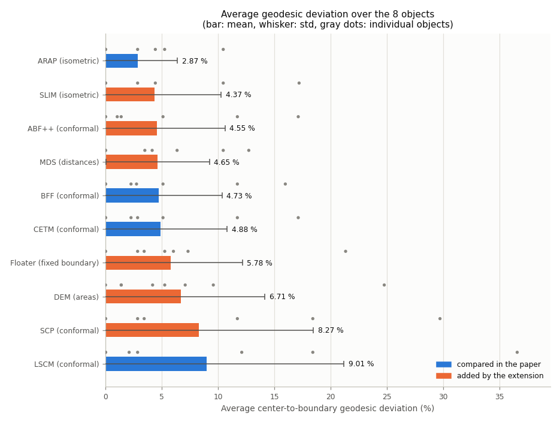
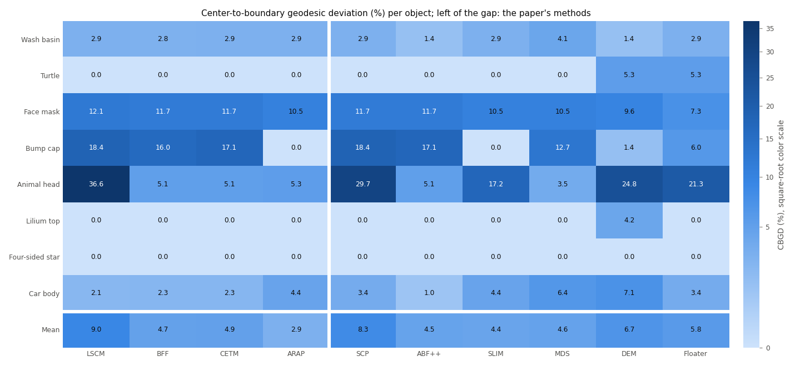
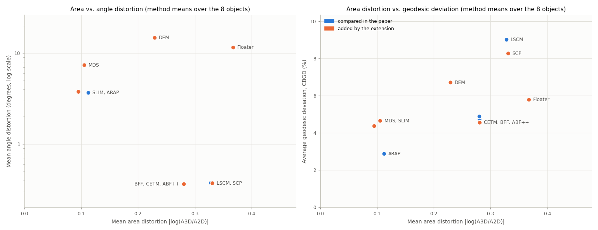
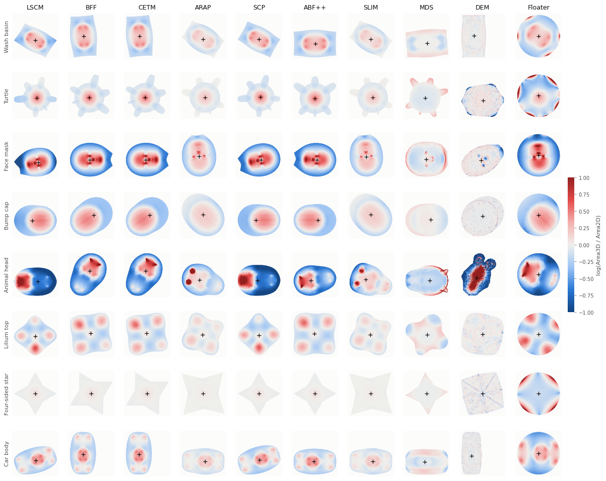
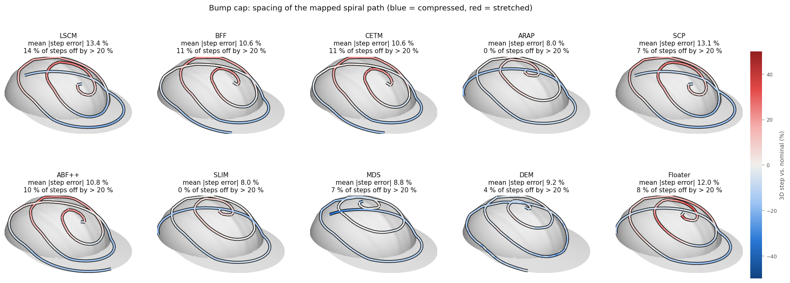
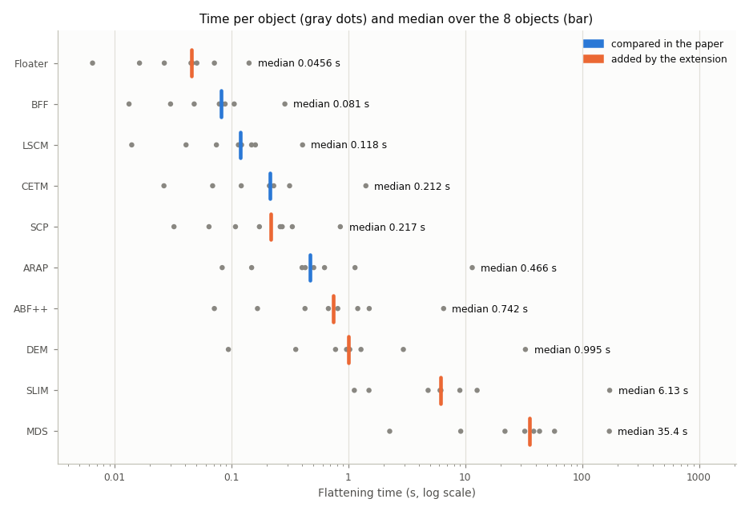

# Mesh flattening for 3D path planning: a replication of Mahrukh et al. (Robotics 2025), extended to ten methods

This repository re-implements and re-runs the comparison in

> M. Mahrukh, G. Palli, M. Gambazza, C. Melchiorri. *Comparative Study on the Suitability of
> Free-Boundary Parameterization Techniques for 3D Geometry-Aware Path Generation.*
> Robotics 2025, 14(11), 160. https://doi.org/10.3390/robotics14110160
> (PDF: [robotics-14-00160-v2.pdf](robotics-14-00160-v2.pdf))

The paper flattens open 3D meshes with four free-boundary parameterizations (LSCM, BFF, ARAP,
CETM), plans a spiral path in the 2D domain, maps it back to 3D, and compares the methods by
area distortion and a new **center-to-boundary geodesic deviation (CBGD)**. Here the four methods
are implemented from scratch with NumPy/SciPy, one module per method, and **six more methods**
are added: two conformal methods the paper leaves out (SCP, ABF++), the isometric SLIM, a
distance-preserving (MDS) and an area-preserving (DEM) flattening, and a fixed-boundary baseline
(Floater). All ten run on eight open, disk-topology meshes chosen to resemble the paper's objects
and are evaluated with the paper's measures plus a few extra ones (angle distortion, path spacing,
validity).

## Headline results

### Replication: the paper's four methods

| | LSCM | BFF | CETM | ARAP |
|---|---:|---:|---:|---:|
| **CBGD, this replication** (mean +- std over 8 objects) | 9.01 +- 12.18 % | 4.73 +- 5.62 % | 4.88 +- 5.91 % | **2.87 +- 3.51 %** |
| CBGD, paper (Fig. 12; BFF and CETM read off the bar chart) | 7.65 % | ~3.9 % | ~6.1 % | **1.7 %** |
| Mean area distortion, mean \|log(A3D/A2D)\| | 0.328 | 0.280 | 0.280 | **0.113** |
| Mean angle distortion (degrees, extra metric) | 0.37 | 0.37 | **0.36** | 3.66 |
| Spiral path: mean 3D step error vs. nominal (extra metric) | 13.4 % | 10.1 % | 10.1 % | **7.9 %** |

**What reproduces:**
- **Ranking.** ARAP has the lowest average deviation and the smallest spread, LSCM the highest
  and the largest spread, and BFF/CETM fall in between. The independent path-spacing measure
  gives the same order.
- **Trade-off.** On average ARAP has 2.5-2.9x less area distortion than the conformal methods,
  which in turn have about 10x less angle distortion. That is the conformal vs. rigid trade-off
  the paper describes.
- **Per-object findings.** The largest, least uniform errors occur on the strongly curved
  shapes: the bump cap, the face mask and the animal-head stand-in for the kitten face. LSCM has
  the highest peak (58.6 % on the animal head), as in the paper, where Bumpcap and Kitten face were
  worst and LSCM peaked highest. The creased four-sided star is perfect for every method.

**What differs:**
- **BFF vs. CETM.** CETM is not worse than BFF here: both use the same boundary condition
  (boundary lengths kept, u_b = 0), and BFF is the linearization of the same discrete conformal
  problem, so the two give nearly identical maps (see *Notes*).
- **Timing order.** Ours is BFF < LSCM < CETM < ARAP; the paper's is LSCM < ARAP < BFF < CETM.
- **Absolute values.** Only the lilium is the paper's source model, so absolute numbers are not
  directly comparable.

### Extension: six more methods

The six added methods go through the same pipeline (same meshes, CBGD, spiral path, poses,
timing) plus a validity check:

| | Year | Preserves | Boundary | Module |
|---|---:|---|---|---|
| **SCP**, spectral conformal parameterization (Mullen et al.) | 2008 | angles | free, no pinned vertices | [scp.py](flattening/scp.py) |
| **ABF++**, angle based flattening (Sheffer et al.) | 2005 | angles, solved in angle space | free | [abf.py](flattening/abf.py) |
| **SLIM**, scalable locally injective mappings (Rabinovich et al.) | 2017 | lengths (symmetric Dirichlet), no flips | free | [slim.py](flattening/slim.py) |
| **MDS**, flattening by multidimensional scaling (Zigelman et al.) | 2002 | geodesic distances | free | [mds.py](flattening/mds.py) |
| **DEM**, density-equalizing map (Choi & Rycroft) | 2018 | areas | free | [dem.py](flattening/dem.py) |
| **Floater**, mean value coordinates (Floater) | 2003 | baseline, bijective | fixed circle | [floater.py](flattening/floater.py) |

Why these:
- SCP and ABF++ are the conformal methods the paper leaves out. SCP removes LSCM's dependence on
  its two pinned vertices (see *Notes*); ABF++ is the algorithm behind Blender's "Angle Based"
  unwrap.
- SLIM minimizes the standard isometric distortion energy and is behind Blender's "Minimum
  Stretch" unwrap (since 4.3); it is ARAP's main modern competitor.
- MDS targets geodesic distances, the quantity CBGD measures, and DEM targets areas, the
  quantity the paper uses to explain CBGD. Both test that explanation directly.
- Floater's fixed circular boundary shows what the paper's free boundaries buy.

Means over the 8 objects (the paper's methods first):

| | CBGD (%) | Area distortion | Angle distortion (deg) | Path step error (%) | Steps off > 20 % | Invalid maps | Time (s) |
|---|---:|---:|---:|---:|---:|---:|---:|
| LSCM | 9.01 +- 12.18 | 0.328 | 0.37 | 13.4 | 21.5 | 0 | 0.135 |
| BFF | 4.73 +- 5.62 | 0.280 | 0.37 | 10.1 | 15.2 | 0 | 0.092 |
| CETM | 4.88 +- 5.91 | 0.280 | 0.36 | 10.1 | 15.2 | 0 | 0.324 |
| ARAP | **2.87 +- 3.51** | 0.113 | 3.66 | **7.9** | **9.6** | 0 | 1.85 |
| SCP | 8.27 +- 10.20 | 0.331 | 0.37 | 13.2 | 20.6 | 0 | 0.261 |
| ABF++ | 4.55 +- 6.06 | 0.281 | **0.36** | 10.7 | 16.6 | 0 | 1.42 |
| SLIM | 4.37 +- 5.92 | **0.095** | 3.75 | 8.5 | 10.2 | 0 | 26.7 |
| MDS | 4.65 +- 4.59 | 0.105 | 7.38 | 10.0 | 13.0 | 1 | 47.0 |
| DEM | 6.71 +- 7.45 | 0.229 | 14.74 | 20.7 | 27.2 | 4 | 5.02 |
| Floater | 5.78 +- 6.38 | 0.368 | 11.54 | 12.9 | 20.9 | 0 | 0.050 |

"Invalid maps" counts objects with flipped triangles or crossing boundary edges. The tables in
[results/tables.md](results/tables.md) give every value per object.

**Findings:**
- **None of the six beats ARAP for this pipeline.** ARAP keeps the lowest mean CBGD (2.87 %) and
  the best path spacing (7.9 % mean step error, 9.6 % of steps off by more than 20 %). SLIM,
  which minimizes a different isometric energy, is second on path spacing (8.5 %) and has the
  least area distortion of all methods (0.095), but on the animal head its CBGD is 17.2 % against
  ARAP's 5.3 %.
- **Less area distortion does not mean less deviation.** On every object the least
  area-distorting map comes from DEM, MDS or SLIM, never from ARAP, yet that map has a higher CBGD
  than ARAP's on 4 of the 8 objects and a lower one on only 2. Per object, the rank correlation
  across the ten methods between CBGD and area distortion is weak (median Spearman rho 0.26)
  and stronger with the path step error (0.52). The area-preserving DEM has the worst path
  spacing (20.7 %): it keeps areas by shearing, which distorts lengths. For spiral paths,
  preserving lengths (ARAP, SLIM) matters more than preserving areas.
- **The extra conformal methods change little.** ABF++ has the lowest angle distortion and is level
  with BFF and CETM (4.55 % CBGD). SCP removes LSCM's pinned vertices but is just as lopsided on the
  animal head (29.7 %).
- **Validity separates the methods.** ARAP, SLIM, the conformal methods and Floater never fold. MDS
  folds the animal head (2,568 flipped triangles); DEM folds four objects, fails outright on the
  animal head, and is the method whose results swing most between remeshings.
- **CBGD alone can mislead.** Floater's fixed circle gives the highest area distortion and a
  12.9 % step error, yet its CBGD (5.8 %) beats LSCM's and SCP's, because CBGD only checks where
  the center lands.
- **Cost.** Floater, BFF, LSCM, SCP and CETM take well under a second per mesh, ABF++ and ARAP one
  to two seconds on average, DEM 5 s (33 s on the animal head), and SLIM and MDS tens of seconds
  (27 s and 47 s on average, about 170 s each on the animal head; MDS spends its time on exact
  geodesics from 128 landmarks).

## Quick start

```bash
python -m venv .venv
.venv\Scripts\activate            # Windows  (Linux/macOS: source .venv/bin/activate)
pip install -r requirements.txt

python run_experiments.py   # flatten + evaluate 8 meshes x 10 methods (~25 min)
python make_figures.py      # figures in results/figures, tables in results/tables.md
python -m pytest            # 49 correctness tests (~10 s)
python make_meshes.py       # optional: rebuild meshes/ from scratch (~1.5 min, needs internet)
```

- `--methods LSCM,BFF,CETM,ARAP` runs only those methods (the paper's four take ~1.5 min); the
  other rows of `results/summary.csv` are kept.
- The committed meshes are the exact ones behind the reported numbers. PyMeshLab's remeshing is
  not bit-reproducible across runs, so `make_meshes.py` gives slightly different meshes each time
  (see *Robustness*).

## Repository layout

```
flattening/            one module per method; each exposes flatten(V, F) -> UV
  common.py              mesh loading/cleaning, boundary loop, cotan Laplacian, harmonic extension,
                         closed boundary curve, local frames and gradient operators
  lscm.py bff.py cetm.py arap.py                   the paper's four methods
  scp.py abf.py slim.py mds.py dem.py floater.py   added by the extension
evaluation.py          area distortion, exact geodesics, 3D and 2D centers, barycentric back-projection,
                       CBGD (Eq. 26), spiral path, tool poses (Eqs. 23-24), validity checks
make_meshes.py         builds meshes/*.obj (procedural shapes + cuts of libigl models, PyMeshLab remeshing)
run_experiments.py     runs everything, writes results/summary.csv and results/data/*.npz
make_figures.py        figures (counterparts of the paper's Figs. 1-12, plus ext_* for all methods)
                       and results/tables.md
tests/                 correctness tests (theory checks, exact isometry, cross-checks with libigl,
                       dense solvers and published numbers)
meshes/                the eight test meshes
results/               summary.csv, tables.md, figures/
```

## Test meshes


| This repo | Paper object | Source | Faces (ours / paper) |
|---|---|---|---:|
| Wash basin | Wash basin | procedural: rectangular slab, rounded-rectangle bowl, drain recess | 10,975 / 10,902 |
| Turtle | Turtle | procedural: domed shell with scutes, head, four flippers, tail | 7,456 / 7,600 |
| Face mask | Face mask (a cowl) | front of the libigl `face.obj` head scan, cut in front of the ears and above the chin | 11,196 / 11,168 |
| Bump cap | Bumpcap | procedural: near-hemispherical ellipsoidal dome with ribs and a creased visor | 14,840 / 15,082 |
| Animal head | Kitten face | top half of the libigl `camelhead.off` (ears, eyes, forehead, upper snout) | 31,934 / 31,954 |
| Lilium top | Lilium top | libigl `lilium.obj`, which matches the paper's figure | 1,848 / 1,844 |
| Four-sided star | Four-sided star | procedural: star pyramid of eight planar facets (creased) | 5,239 / 5,344 |
| Car body | Car body | procedural: rounded body shell with steep sides and a cabin | 12,739 / 12,763 |

- **Cleaning.** Every mesh goes through the paper's cleaning step: merge duplicate vertices,
  drop degenerate, duplicate and unreferenced faces, make the winding consistent, keep the
  largest component. It is then checked to be a topological disk.
- **Remeshing.** Every mesh is then remeshed with the PyMeshLab filter the paper uses
  (`meshing_isotropic_explicit_remeshing`, 10 iterations, 30 degree crease angle). The target edge
  length is chosen to match the paper's face count, which gives mean edge lengths of 0.65-2.7 %
  (mostly ~1 %) of the bounding-box diagonal.
- **Lilium.** The remeshed lilium (974 vertices / 1,848 faces) is almost identical to the
  paper's (975 / 1,844). Together with the matching shape, this suggests the paper used the same
  model.
- **libigl sources.** The libigl models come from
  [libigl-tutorial-data](https://github.com/libigl/libigl-tutorial-data), pinned to commit `644dd41`.
  That repository has no explicit license, and it lists the origin of `face.obj` and `lilium.obj`
  as unknown; `camelhead.off` is from Sorkine et al. 2004.

## Methods as implemented

### The paper's four methods

**LSCM** ([flattening/lscm.py](flattening/lscm.py))
- Minimizes the conformal energy E_C = E_D - A = 1/2 x^T (L (x) I_2 - 2 A_vec) x, which is the
  sparse system quoted in the paper: Dirichlet energy minus the signed area of the map.
- The two boundary vertices that are farthest apart are pinned to (0, 0) and (1, 0).
- Solved with a sparse direct solver.
- Cross-check: the result matches libigl's `lscm` to 1e-9.

**BFF** ([flattening/bff.py](flattening/bff.py)), minimum-distortion setting u_b = 0:
- Interior log scale factors come from the discrete Yamabe/Cherrier relation K_new = K + L u
  with a flat interior. This is the Dirichlet-to-Neumann (Poincare-Steklov) map, realized with a
  Poisson solve.
- The new boundary exterior angles are k_new = k + (L u)_B.
- The boundary curve is integrated from the turning angles, with the edge lengths adjusted as
  little as possible so that it closes (Sawhney & Crane, Sec. 4.3).
- The interior comes from a harmonic (Laplace) extension with the input mesh's cotangent
  Laplacian, as the paper describes.

**ARAP** ([flattening/arap.py](flattening/arap.py)):
- Liu et al.'s local/global solver, with cotangent weights and one rotation per triangle.
- Local step: the closest rotation to each 2x2 Jacobian, in closed form theta = atan2(c - b, a + d).
  This is equivalent to the SVD solution and stable for near-degenerate triangles.
- Global step: a pre-factorized cotangent Laplacian solve with one vertex pinned.
- Initialization: a harmonic map whose boundary is spaced by arc length on a circle (as in the
  paper and the libigl tutorial).
- Stopping rule: iterate until the largest vertex displacement falls below 1e-6 x the mean edge
  length.
- Cross-check: after a fixed number of iterations, the result matches libigl's `arap_solve` to a
  relative 1e-8.

**CETM** ([flattening/cetm.py](flattening/cetm.py)):
- Discrete conformal scaling l_ij = exp((u_i + u_j)/2) l_ij with u = 0 at boundary vertices and
  target angle sum 2 pi at interior vertices.
- Newton's method on the convex Springborn-Schroeder-Pinkall energy: the gradient is the target
  minus the current angle sums, and the Hessian is the cotangent Laplacian. The energy uses the
  Lobachevsky function, computed via the Clausen series.
- An Armijo line search accepts only steps that keep every triangle inequality satisfied.
- Layout: the boundary polygon is built from the new lengths and exterior angles, then extended
  harmonically with the cotangent weights of the *new flat metric*. By linear precision this
  reproduces the developed triangles exactly; tests confirm edge lengths and 2 pi angle sums to 1e-8.

### The six added methods

**SCP**, Spectral Conformal Parameterization, Mullen et al. 2008 ([flattening/scp.py](flattening/scp.py))
- The same conformal energy as LSCM, but instead of pinning two vertices it takes the generalized
  eigenvector L_C u = lambda B u with the smallest non-trivial lambda (B: ones at boundary vertices).
  This removes the pin dependence documented for LSCM in the replication.
- Solved as the paper's Eq. 7 with ARPACK (largest mu of (B - e_b e_b^T / V_b) u = mu M u).
- One deliberate deviation: the paper uses M = L_C + eps I (eps = 1e-8) as a safeguard. That
  perturbs the eigenvector (on the animal head the area distortion moves by 0.7 %). M = L_C + eps B
  is positive definite as well and provably leaves the eigenvectors of Eq. 5 unchanged, so we use it.
- Verified: L_C u = lambda B u to 1e-7 or better on every mesh; matches a dense solve of the
  paper's eps I formulation as eps -> 0 (residual proportional to eps, 1e-13 at eps = 1e-13); exact
  on the developable sheet; lower E_C / (boundary moment) than LSCM.

**ABF++**, Angle Based Flattening, Sheffer et al. 2005 ([flattening/abf.py](flattening/abf.py))
- Optimizes the 3m corner angles directly: minimize sum (alpha - beta)^2 / beta^2 subject to
  triangle sums pi, interior vertex sums 2 pi and the wheel (sine) condition that makes edge lengths
  consistent. beta are the 3D angles scaled to 2 pi around interior vertices.
- Newton steps without the constraints' second derivatives (sequential linearly constrained
  programming), with the two ABF++ Schur-complement reductions; target angles, weights and step
  control follow the authors' implementation in Geogram. We iterate to a KKT residual of 1e-10
  (4-10 iterations on our meshes) rather than Geogram's loose tolerance.
- (u, v) from the angles by the angle-based least-squares system ABF++ uses (as Geogram and Blender
  do); with converged angles it is exact.
- Verified: the constraints hold to 1e-9 and every final map realizes its optimized angles to
  1e-9 or better; the ABF energy of the result is lower than that of the angles of every other
  method's map.

**SLIM**, Scalable Locally Injective Mappings, Rabinovich et al. 2017 ([flattening/slim.py](flattening/slim.py))
- Minimizes the symmetric Dirichlet energy sum A_t (|J_t|^2 + |J_t^-1|^2), the standard isometric
  distortion energy, by reweighted local/global proxies with a line search that never degenerates a
  triangle (locally injective). Blender 4.3's "Minimum Stretch" unwrap is based on SLIM.
- Mirrors libigl's slim_solve (proximal term, weights, flip-avoiding line search); initialized like
  our ARAP (harmonic map onto a circle, Tutte's embedding if that flips).
- Stops when the relative energy decrease falls below 1e-10 (tolerance study below).
- Verified: matches libigl's slim_solve to ~1e-11 after 1, 5 and 25 iterations; lowest symmetric
  Dirichlet energy of all methods (each compared at its optimal scale); converges to the exact
  isometry on the developable sheet.

**MDS**, surface flattening by multidimensional scaling, Zigelman et al. 2002 ([flattening/mds.py](flattening/mds.py))
- Places the vertices so that planar distances best match geodesic distances (classical MDS),
  i.e. it targets the quantity CBGD measures.
- Classical scaling of 128 landmark vertices (geodesic farthest-point sampling, exact MMP
  geodesics), with the other vertices placed by landmark MDS (de Silva & Tenenbaum 2004). Zigelman
  et al. likewise flatten a subset of anchor vertices (25 x 25 on their 40,000-vertex surfaces) and
  interpolate the rest. Reflection fixed so the map preserves orientation.
- Verified: landmark MDS with every vertex a landmark equals classical MDS to 1e-15; exact on the
  developable sheet.

**DEM**, density-equalizing map, Choi & Rycroft 2018 ([flattening/dem.py](flattening/dem.py))
- Area-preserving free-boundary flattening by Gastner-Newman diffusion: population = 3D triangle
  area; the density population / (2D area) is diffused on the deforming 2D mesh and the vertices
  move with -grad(rho) / rho until it is uniform.
- Follows the paper and the authors' MATLAB code (DEM_main): curvature-based convex boundary and
  Tutte initialization, a "sea" made by reflecting the disk through the unit circle, backward-Euler
  diffusion with the cotangent Laplacian, stop at std/mean < 1e-3 (at most 49 steps). Only the
  gap triangulation differs: a Delaunay triangulation with lattice points removed from the boundary
  edges' diametral circles instead of a constrained Delaunay triangulation.
- Verified against the paper's Table 5.1 on the authors' own example data (square, hexagon, peaks):
  median density 1.0120 / 1.0233 / 1.0026 (paper 1.0126 / 1.0227 / 1.0024), IQR 0.071 / 0.055 /
  0.130 (paper 0.080 / 0.056 / 0.133), 5 / 5 / 3 steps (paper 5 / 5 / 4).

**Floater**, mean value coordinates, Floater 2003 ([flattening/floater.py](flattening/floater.py))
- Fixed-boundary baseline: boundary on a circle (arc-length spacing), interior vertices as convex
  combinations of their neighbors with mean value weights. Bijective by Tutte's theorem.
- Verified: reproduces a planar mesh exactly when its boundary is fixed (linear precision).

### Considered but not included
- **Beltrami coefficient prolongation** (Fargion & Weber, Eurographics 2026): a newer injective,
  low-distortion method for disk meshes; its code needs MATLAB, CGAL and PARDISO.
- **Neural methods.** No published neural flattening method can be used without training network
  weights. FAM (Zhang et al., NeurIPS 2024), its successor FlexPara, ParaPoint and Nuvo fit a fresh
  network to every input surface (their official code ships no checkpoints); Neural Jacobian
  Fields releases weights only for its morphing demo, so UV flattening means training it on a
  dataset first; and the learned methods built for exactly this setting, learned metric fields
  (Fargion & Weber 2025) and the Spectral Beltrami Network (Xu & Lui, arXiv 2025), have no public
  code or weights. This repository deliberately contains no trained weights, so it has no neural
  method.
- **CEPS** (Gillespie, Springborn & Crane 2021): the robust successor of CETM, which avoids CETM's
  failures on bad triangles by intrinsic edge flips. It needs an intrinsic-triangulation data
  structure, a large addition; our meshes are remeshed so CETM does not fail on them.
- **SCAF** (Jiang et al. 2017): SLIM's energy plus a scaffold mesh that also prevents global
  overlaps. SLIM's maps have no boundary overlaps here, the failure SCAF addresses.
- **Cut-based and multi-chart methods** (OptCuts, PartUV): they cut the surface into several
  charts, while the paper's pipeline needs one disk-shaped map.
- **DCP / ASAP**: the natural-boundary discrete conformal map and the as-similar-as-possible map
  are equivalent to LSCM.

## Evaluation as implemented ([evaluation.py](evaluation.py))

- **Area distortion.** Per face, log(A3D / A2D), with both domains scaled to unit total area.
  The maps use UV scaled to the unit box and a color range of +-1, as in the paper. The summary
  value is the mean of the absolute value over faces.
- **True center P_t.** The vertex with the largest exact geodesic distance to the boundary
  (MMP algorithm via `pygeodesic`).
- **Mapped center P_m.**
  - Start from the pole of inaccessibility of the UV boundary polygon (polylabel branch and
    bound, tolerance 1e-4 of the UV size).
  - Locate it in the UV mesh and back-project it with barycentric weights (Eq. 22), using the
    paper's rules: accept weights >= -1e-9, clamp and renormalize, break ties by the largest
    minimum weight.
  - Snap to the vertex of the containing triangle closest to the back-projected 3D point.
    Geodesics are vertex-sourced and P_t is a vertex, which is also why the paper's Fig. 10
    shows exact zeros.
- **CBGD.** delta_i = (d(P_m, b_i) - d(P_t, b_i)) / d(P_t, b_i) over all boundary vertices (Eq. 26).
  The "average geodesic deviation" is the mean of |delta_i| in percent; Fig. 12 shows mean +- std
  over the objects.
- **Spiral path.**
  - Three turns from the 2D center. The radius grows with the polar angle up to 98 % of the
    distance to the boundary in that direction, so the outer turn follows the boundary.
  - The UV frame is scaled to [0, 100] with a step of 3.2, as in the paper's example.
  - Via points are back-projected with Eq. 22.
- **Path spacing (extra).** The 3D chord between consecutive via points, compared with the
  nominal step 3.2 x sqrt(A3D / A2D). The paper motivates CBGD with a 15-20 % spacing tolerance
  but does not measure spacing itself.
- **Tool poses (Eqs. 23-24).** Computed for every path and saved with the run data. The paper's
  R_i = [T_i, N_i x T_i, -N_i] has determinant -1 (a reflection), so we use
  [T_i, T_i x N_i, -N_i]. Inverse kinematics (Eq. 25) needs a robot model and is out of scope.
- **Validity checks.**
  - The paper checks positive boundary area; we also count flipped or degenerate UV triangles,
    crossing pairs of boundary edges and unmapped via points. A map without flipped triangles
    whose boundary does not cross itself is one-to-one.
  - All 32 runs of the paper's four methods are valid. Of the 48 runs of the added methods, 5
    produce invalid maps: MDS on the animal head and DEM on the turtle, face mask, bump cap and
    animal head. No run leaves via points unmapped.
  - Every map is continuous on the mesh, so the 2D center and every via point always fall in some
    triangle, even when a map folds; the measures are therefore defined for invalid maps too.
- **Timing.** The flattening call only: median of three runs, or a single run for methods that
  take longer than 60 s (Windows 11, Python 3.11, NumPy 2.2, one laptop).

## Results

All numbers below are also in [results/summary.csv](results/summary.csv) and
[results/tables.md](results/tables.md), which give every measure for all ten methods.

### The paper's four methods

**Average center-to-boundary geodesic deviation, mean |delta_i| (%)**

| Object | LSCM | BFF | CETM | ARAP |
|---|---:|---:|---:|---:|
| Wash basin | 2.85 | 2.76 | 2.85 | 2.85 |
| Turtle | 0.00 | 0.00 | 0.00 | 0.00 |
| Face mask | 12.11 | 11.72 | 11.72 | 10.46 |
| Bump cap | 18.42 | 15.98 | 17.12 | 0.00 |
| Animal head | 36.57 | 5.11 | 5.11 | 5.26 |
| Lilium top | 0.00 | 0.00 | 0.00 | 0.00 |
| Four-sided star | 0.00 | 0.00 | 0.00 | 0.00 |
| Car body | 2.10 | 2.27 | 2.27 | 4.43 |
| **Mean +- std** | **9.01 +- 12.18** | **4.73 +- 5.62** | **4.88 +- 5.91** | **2.87 +- 3.51** |

**Mean absolute area distortion, mean |log(A3D/A2D)|**

| Object | LSCM | BFF | CETM | ARAP |
|---|---:|---:|---:|---:|
| Wash basin | 0.207 | 0.198 | 0.198 | 0.085 |
| Turtle | 0.133 | 0.129 | 0.129 | 0.056 |
| Face mask | 0.442 | 0.429 | 0.428 | 0.196 |
| Bump cap | 0.263 | 0.248 | 0.248 | 0.099 |
| Animal head | 1.235 | 0.919 | 0.918 | 0.322 |
| Lilium top | 0.165 | 0.147 | 0.146 | 0.060 |
| Four-sided star | 0.017 | 0.016 | 0.016 | 0.006 |
| Car body | 0.164 | 0.158 | 0.158 | 0.075 |
| **Mean +- std** | **0.328 +- 0.361** | **0.280 +- 0.265** | **0.280 +- 0.265** | **0.113 +- 0.094** |

**Parameterization time in seconds (counterpart of Table 2)**

| Object | LSCM | BFF | CETM | ARAP |
|---|---:|---:|---:|---:|
| Wash basin | 0.122 | 0.088 | 0.213 | 0.624 |
| Turtle | 0.074 | 0.048 | 0.121 | 1.138 |
| Face mask | 0.114 | 0.078 | 0.229 | 0.401 |
| Bump cap | 0.160 | 0.105 | 0.314 | 0.505 |
| Animal head | 0.405 | 0.286 | 1.410 | 11.467 |
| Lilium top | 0.014 | 0.013 | 0.026 | 0.083 |
| Four-sided star | 0.041 | 0.030 | 0.069 | 0.148 |
| Car body | 0.148 | 0.083 | 0.211 | 0.427 |
| **Mean +- std** | **0.135 +- 0.113** | **0.092 +- 0.079** | **0.324 +- 0.420** | **1.849 +- 3.648** |

Paper: LSCM 0.067 +- 0.043, ARAP 0.241 +- 0.133, BFF 0.297 +- 0.522, CETM 0.457 +- 0.454 s.
Our ARAP time is set by its stopping rule. The results are identical (CBGD and area distortion
to 5 digits) for tolerances from 1e-3 to 1e-7, while the time on the animal head grows roughly
eightfold over that range.

**Per-object figures (counterparts of Figs. 2-9).** Each figure shows the area distortion maps
(+ marks the 2D center) and the geodesic distances from the true and the mapped center to the
boundary:
[wash basin](results/figures/object_wash_basin.png) ·
[turtle](results/figures/object_turtle.png) ·
[face mask](results/figures/object_face_mask.png) ·
[bump cap](results/figures/object_bump_cap.png) ·
[animal head](results/figures/object_animal_head.png) ·
[lilium top](results/figures/object_lilium_top.png) ·
[four-sided star](results/figures/object_four_sided_star.png) ·
[car body](results/figures/object_car_body.png)


**Deviation profiles (Fig. 10)**


**Area distortion vs. deviation (Fig. 11).** Faceted by method because four hues in one
scatter are not reliably distinguishable:


**Average deviation (Fig. 12)**


**Spiral path, ARAP on the lilium (Fig. 1)**


**Path spacing on the bump cap (extra).** Blue marks compressed steps, red stretched:


### All ten methods

The extension figures color only the paper's methods (blue) against the added ones (orange) and
label every method directly, because ten hues are not reliably distinguishable.

**Average deviation.** Bars are means over the 8 objects, whiskers the standard deviation, gray
dots the individual objects:



**CBGD per object:**



**Distortion trade-offs** (method means):



**Area distortion maps** of every method (columns) on every object (rows); + marks the 2D center:



Larger per-object versions with CBGD and validity:
[wash basin](results/figures/ext_object_wash_basin.png) ·
[turtle](results/figures/ext_object_turtle.png) ·
[face mask](results/figures/ext_object_face_mask.png) ·
[bump cap](results/figures/ext_object_bump_cap.png) ·
[animal head](results/figures/ext_object_animal_head.png) ·
[lilium top](results/figures/ext_object_lilium_top.png) ·
[four-sided star](results/figures/ext_object_four_sided_star.png) ·
[car body](results/figures/ext_object_car_body.png)

**Path spacing on the bump cap:**



**Time** per object (log scale):



## Notes, robustness and caveats

### The replication

- **BFF ≈ CETM.**
  - The paper gives "K̄_i = π" as the CETM target for every boundary vertex. That cannot
    satisfy the discrete Gauss-Bonnet theorem, because the boundary turning must sum to 2 pi.
  - We therefore use the standard free-boundary choice u_b = 0 (Springborn et al. 2008), which
    is also BFF's minimum-distortion setting. BFF is the linearization of that problem, so the
    two maps differ only by second-order terms: their mean area distortions differ by at most
    0.001 on every object.
  - The paper found CETM clearly worse than BFF (6.1 vs. 3.9 %), which suggests a different
    CETM boundary treatment or layout in its implementation.
- **CBGD is quantized to vertices.**
  - P_t and P_m are vertices, so a sub-edge mismatch shows up as exactly 0, while a shift of one
    or two vertices already gives about 2-3 % CBGD on these meshes (wash basin, car body). Many
    entries are therefore exactly 0 or equal across methods (e.g. the wash basin), as in the paper.
  - **Robustness check.** Two independent remeshings of the same inputs moved single entries by
    up to 1.5 points (wash basin LSCM 4.31 -> 2.85 %, bump cap BFF 17.13 -> 15.98 %). The method
    means moved by at most 0.2 points (LSCM 9.19 -> 9.01, BFF 4.89 -> 4.73, CETM 4.89 -> 4.88,
    ARAP 2.88 -> 2.87 %), and the ranking was unchanged.
- **Centers on elongated shapes are ill-conditioned.** On the wash basin and the car body, the
  distance to the boundary has an almost flat ridge, so both centers can slide along it under
  small changes.
- **LSCM depends on the pinned pair.**
  - Farthest pair (used here), loop index 0 / n/2 (libigl tutorial), and loop index n/4 / 3n/4
    give CBGD 36.6 / 35.2 / 21.9 % on the animal head and 12.1 / 9.6 / 13.8 % on the face mask.
  - Area distortion changes by less than 2.5 %.
  - The animal-head LSCM map is the known lopsided two-pin solution (Mullen et al. 2008).
- **CETM needs reasonably shaped triangles.** Without intrinsic edge flips, CETM fails when the
  flat metric would break a triangle inequality.
  - This happened on the raw camel head (input angles up to 177 degrees) and on a first face-mask
    cut that kept thin ear fragments (a 161 degree triangle).
  - The paper's remedy, isotropic remeshing, is applied to every mesh here, and the face cut was
    moved in front of the ears.
- **ARAP is pure ARAP.** The paper's "unit weighting factor lambda = 1" is ambiguous; it
  otherwise describes ARAP as the lambda -> infinity end of Liu et al.'s family, which is what is
  implemented.
- **Point location.** The paper accelerates point location with a uniform grid. We test all
  faces directly, which gives the same results more slowly.

### The extension

- **Robustness.** All ten methods were rerun on an independent remeshing of the same inputs
  (PyMeshLab gives slightly different meshes each time). Mean CBGD moved by at most 0.2
  points for eight of them (LSCM 9.01 -> 9.19, BFF 4.73 -> 4.89, CETM 4.88 -> 4.89, ARAP 2.87 ->
  2.88, SCP 8.27 -> 8.27, ABF++ 4.55 -> 4.73, SLIM 4.37 -> 4.37, Floater 5.78 -> 5.78 %), more for
  MDS (4.65 -> 4.14 %) and DEM (6.71 -> 9.57 %; animal head 24.8 -> 40.6 %, wash basin 1.4 -> 8.5 %).
  The rankings by area distortion, angle distortion and path step error were the same (up to the
  tied BFF and CETM); by CBGD, ARAP stayed first while the methods between 4 and 5 % reordered.
  Differences of a point or less in mean CBGD are therefore not meaningful.
- **SLIM's stopping rule.** SLIM stops when the relative energy decrease falls below 1e-10. In a
  separate study run, between 1e-6 and 1e-10 the CBGD of the lilium, bump cap and animal head did
  not change and area distortion changed by less than 0.001, while the time on the animal head
  grew about sixfold (30 s at 1e-6, 190 s at 1e-10). On the face mask, CBGD flips to 9.58 % at
  1e-8 (vertex quantization) and is 10.46 % at 1e-9 and 1e-10. On the developable sheet the distance to the exact isometry shrinks like the
  square root of the tolerance (4e-4 degrees at 1e-10), so the tests run it at 1e-14.
- **MDS landmarks.** In a separate study run with 32 / 64 / 128 / 256 landmarks, area distortion
  converged slowly (bump cap 0.045 / 0.043 / 0.042 / 0.040) while CBGD jumped by vertex
  quantization (bump cap 13.7 / 12.1 / 12.7 / 12.1 %), and the time grew linearly with the number
  of landmarks (animal head 50 / 103 / 202 / 411 s); 128 is used.
  On the animal head every landmark count gives 2,500-2,800 flipped triangles: its geodesic
  distances are far from those of any planar point set.
- **DEM fails on the animal head.** Tutte's embedding compresses the ears so much that the initial
  density spans a factor of 2.3e5. The first diffusion step moves vertices by up to 8 edge
  lengths and flips 873 triangles; the flow then equalizes the diffused density while the mesh
  folds (4,669 flipped triangles after the 49 steps the authors' code allows). With 10x smaller
  steps and 500 steps it still ends with 4,157 flips, so this is a limitation of the 2018 method
  (the authors' 2024 follow-ups add an overlap correction), not of the step size. The locally
  authalic start that the authors use for scanned faces lowers the area distortion on every mesh
  but does not fix the animal head (10,568 flips) and adds flips elsewhere (44 on the bump cap),
  so the code's default Tutte start is kept. DEM also flips a few triangles on the turtle (4),
  face mask (19) and bump cap (1).
- **SCP does not fix what LSCM's pins break.** SCP needs no pins, but on the animal head it is as
  lopsided as LSCM (CBGD 29.7 %, inside LSCM's range of 21.9-36.6 % over pin choices): both
  minimize the same conformal energy with only a normalization. With the paper's eps I
  regularization instead of eps B, the animal head's CBGD is 30.4 % and the car body's 2.1 %
  instead of 3.4 %, another example of how much vertex quantization amplifies small changes.
- **ABF++ angle clamps.** The 3-175 degree clamp on the target angles (from the authors' code)
  only touches 3 angles of the animal head, whose smallest triangle angle is 2.2 degrees.

## References

1. B. Levy, S. Petitjean, N. Ray, J. Maillot. Least Squares Conformal Maps for Automatic Texture Atlas Generation. ACM TOG 21(3), 2002.
2. R. Sawhney, K. Crane. Boundary First Flattening. ACM TOG 37(1), 2017.
3. L. Liu, L. Zhang, Y. Xu, C. Gotsman, S. J. Gortler. A Local/Global Approach to Mesh Parameterization. CGF 27(5), 2008.
4. B. Springborn, P. Schroeder, U. Pinkall. Conformal Equivalence of Triangle Meshes. ACM TOG 27(3), 2008.
5. P. Mullen, Y. Tong, P. Alliez, M. Desbrun. Spectral Conformal Parameterization. CGF 27(5), 2008.
6. J. Mitchell, D. Mount, C. Papadimitriou. The Discrete Geodesic Problem. SIAM J. Comput. 16(4), 1987 (exact geodesics).
7. A. Sheffer, B. Levy, M. Mogilnitsky, A. Bogomyakov. ABF++: Fast and Robust Angle Based Flattening. ACM TOG 24(2), 2005.
8. M. Rabinovich, R. Poranne, D. Panozzo, O. Sorkine-Hornung. Scalable Locally Injective Mappings. ACM TOG 36(2), 2017.
9. G. Zigelman, R. Kimmel, N. Kiryati. Texture Mapping Using Surface Flattening via Multidimensional Scaling. IEEE TVCG 8(2), 2002.
10. V. de Silva, J. B. Tenenbaum. Sparse Multidimensional Scaling Using Landmark Points. Technical report, Stanford University, 2004.
11. G. P. T. Choi, C. H. Rycroft. Density-Equalizing Maps for Simply Connected Open Surfaces. SIAM J. Imaging Sciences 11(2), 2018.
12. M. T. Gastner, M. E. J. Newman. Diffusion-Based Method for Producing Density-Equalizing Maps. PNAS 101(20), 2004.
13. M. S. Floater. Mean Value Coordinates. Computer Aided Geometric Design 20(1), 2003.
14. Q. Zhang, J. Hou, W. Wang, Y. He. Flatten Anything: Unsupervised Neural Surface Parameterization. NeurIPS 2024.
